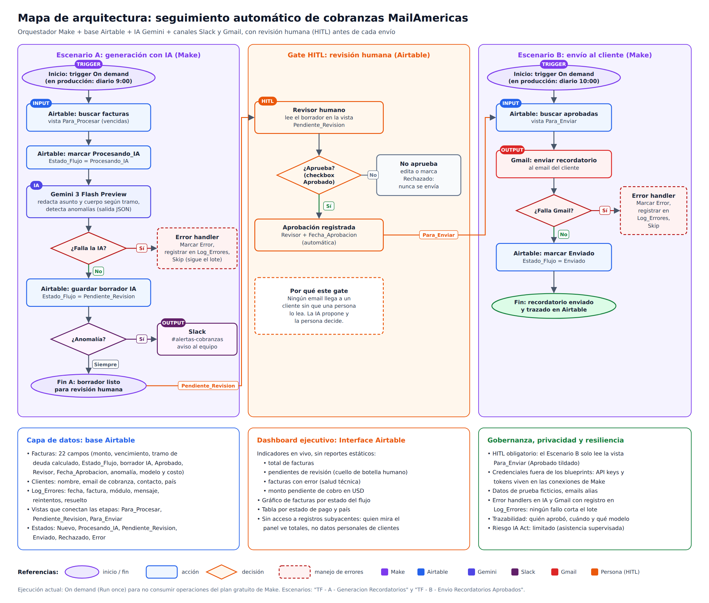

# Seguimiento automático de cobranzas MailAmericas

Trabajo Final del curso **IA Automation** de Coderhouse (2026).

Sistema que automatiza los recordatorios de pago de facturas vencidas: la IA redacta cada email según los días de atraso, una persona lo aprueba y recién entonces se envía al cliente. Todo queda registrado en Airtable.

> Los clientes, montos y facturas son ficticios. Los emails de los clientes son alias de una cuenta de prueba.

## Links

| Recurso | Link |
| --- | --- |
| Documento completo (PDF) | [Trabajo-Final-Cobranzas-MailAmericas.pdf](Trabajo-Final-Cobranzas-MailAmericas.pdf) |
| Base de Airtable (solo lectura) | [TF - MailAmericas Cobranzas](https://airtable.com/app7mr3xIlsDQ4rrM/shrLpjcQcHW2m4fLQ) |
| Dashboard de control ejecutivo | [Panel de Control - Cobranzas](https://airtable.com/app7mr3xIlsDQ4rrM/shrJM3q3CaFV2DgeE) |
| Video demo | [Google Drive](https://drive.google.com/drive/folders/1g_qDM_-IHQB-2yred8V3hq0C4pKFz0J4) |

## Arquitectura

1. **Escenario A, generación con IA (Make):** busca las facturas vencidas, marca cada una como `Procesando_IA`, le pide a Gemini un borrador con el tono según el tramo de deuda, guarda el borrador en `Pendiente_Revision` y avisa por Slack si Gemini detecta una anomalía.
2. **Gate HITL (Airtable):** un revisor lee el borrador y tilda `Aprobado`. Airtable registra quién aprobó y cuándo. Sin aprobación, nada se envía.
3. **Escenario B, envío (Make):** toma solo las facturas aprobadas, envía el email por Gmail y marca la factura como `Enviado`.

Los dos escenarios tienen una ruta de error: si falla Gemini o Gmail, la factura pasa a `Error`, se registra en la tabla `Log_Errores` y el lote sigue con las demás facturas.

## Stack

| Categoría | Herramienta |
| --- | --- |
| Orquestador | Make.com |
| Base de datos | Airtable |
| Inteligencia artificial | Google Gemini 3 Flash Preview |
| Canales | Gmail (cliente) y Slack (equipo) |

## Contenido del repositorio

| Archivo | Contenido |
| --- | --- |
| `Trabajo-Final-Cobranzas-MailAmericas.pdf` | Documento completo: arquitectura, manual de datos y JSON, matriz de costos, malla de seguridad, dashboard y evidencias |
| `arquitectura-cobranzas-mailamericas.png` / `.svg` | Mapa de arquitectura |
| `TF_-_A_-_Generacion_Recordatorios_blueprint.json` | Blueprint del Escenario A |
| `TF_-_B_-_Envio_Recordatorios_Aprobados_blueprint.json` | Blueprint del Escenario B |
| `capturas/` | Evidencias de las pruebas: lote procesado, anomalía, errores forzados, aprobación, envío, log y dashboard |

## Cómo importar los escenarios en Make

1. En Make, crear un escenario nuevo.
2. En el menú de los tres puntos (abajo), elegir **Import Blueprint** y subir el archivo `.json`.
3. Crear las conexiones propias de Airtable, Gemini, Slack y Gmail. Los blueprints no incluyen credenciales.
4. Apuntar los módulos de Airtable a una copia de la base.

## Seguridad

- Ningún email sale sin aprobación humana: el Escenario B solo lee la vista `Para_Enviar`, que exige `Aprobado` tildado.
- Las API keys y tokens viven en las conexiones de Make; no están en este repositorio.
- El dashboard muestra solo totales, sin acceso a datos de clientes.
